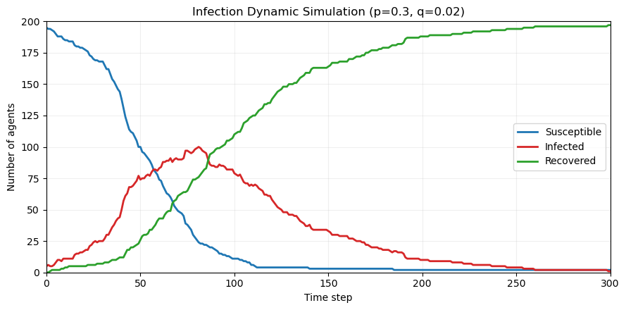
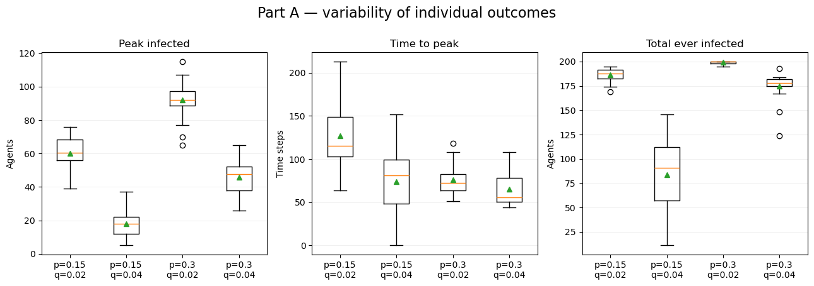
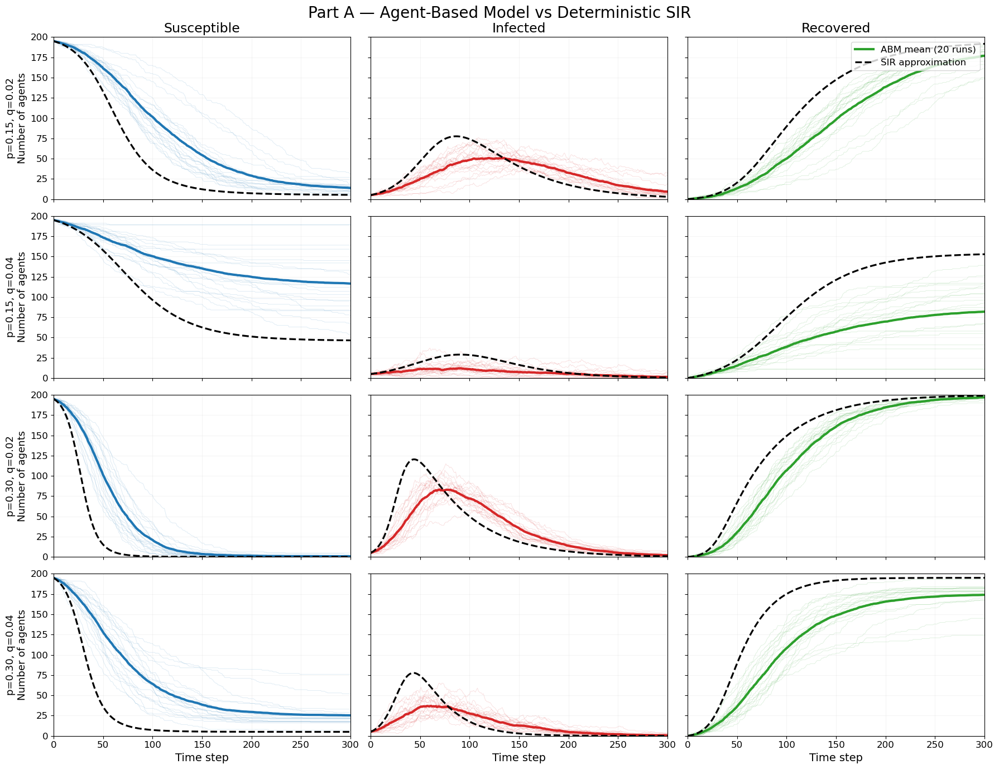
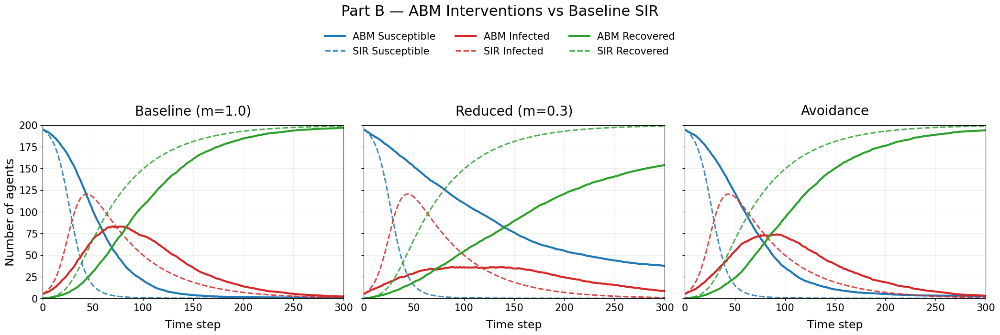
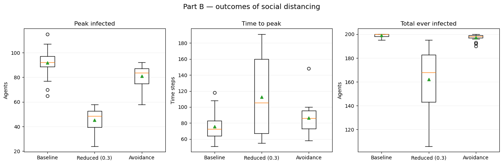
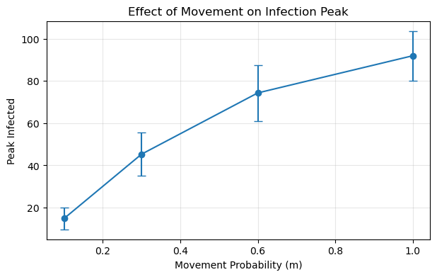
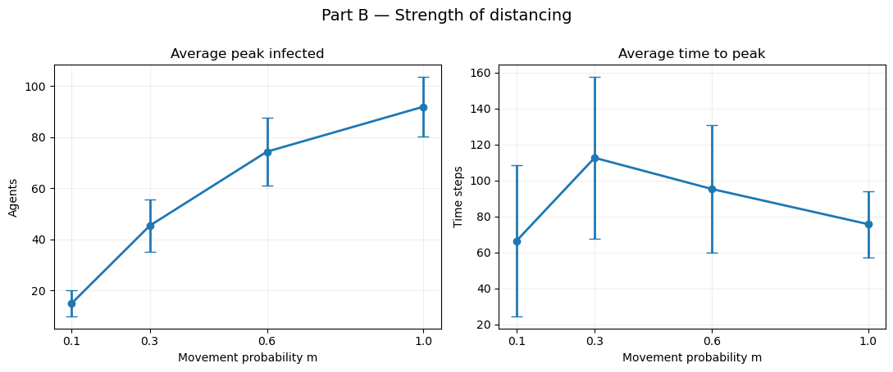

# HW 2 — Agent-Based Modeling of Pandemic Spread

**Name:** Lige Zhang  
**Email:** lige.zhang@emory.edu  
**Question:** HW 2 — Agent-Based Modeling of Pandemic Spread  
**Course:** BMI 500, Lecture 7 Homework

## Overview

This project simulates the spread of an infectious disease using an **agent-based model (ABM)** and examines how transmission, recovery, and social distancing influence outbreak dynamics. The results are also compared qualitatively with a **deterministic SIR reference model**.

## Model and experiments

- **Population:** 200 agents (initially 195 susceptible, 5 infected, 0 recovered) on a bounded **20 × 20** grid.
- **Movement:** Each agent randomly chooses to stay or move one cell up, down, left, or right; positions remain within the grid.
- **Transmission:** A susceptible agent sharing a cell with at least one infected agent becomes infected with probability **`p`** per step.
- **Recovery:** An infected agent recovers with probability **`q`** per step and remains immune.
- **Simulation:** 300 time steps, **20 seeded runs per condition**. We record susceptible (S), infected (I), and recovered (R) counts at each step.

The reported *peak infected* and *time to peak* are the means of the corresponding **per-run** outcomes, rather than the peak of the ensemble-average infection curve. *Ever infected* is `200 − S(300)`, including the five initially infected agents.

## Part A — Base model and sensitivity analysis



We conducted simulations through four combinations of transmission probability (`p = 0.15, 0.30`) and recovery probability (`q = 0.02, 0.04`). The result is shown by Table below:

| Transmission `p` | Recovery `q` | Mean peak infected | Mean time to peak | Mean ever infected by step 300 |
|---:|---:|---:|---:|---:|
| 0.15 | 0.02 | 60.00 | 126.95 | 186.25 |
| 0.15 | 0.04 | 17.85 | 73.85 | 83.40 |
| 0.30 | 0.02 | 91.90 | 75.80 | 199.15 |
| 0.30 | 0.04 | 45.85 | 65.15 | 174.70 |

**Discussion.** We found that a higher transmission probability ($p$) produces larger, generally earlier peaks and more infections; higher recovery probability ($q$) suppresses the peak and reduces infections. Individual runs vary because initial agent locations, movement, transmission, and recovery are random. Variability also depends on the setting: for example, the standard deviation of total infections was **38.71** for `p=0.15, q=0.04`, versus **1.31** for `p=0.30, q=0.02`. We defined *early extinction* as reaching zero infected agents by step 100, and we only observed **2 of 80 runs** that an early extinction occurs.



### Comparison with classical SIR

For a reference comparison, we asked GPT to implement a deterministic SIR model using a simple approximate parameter mapping, `β = p / 400` and `γ = q`. This mapping assumes approximately homogeneous spatial mixing and **was not fitted to the ABM**. Both models show the broad S–I–R epidemic pattern, but their peak timing and magnitudes differ because the ABM explicitly includes random, spatially constrained encounters.



## Part B — Social distancing interventions

With `p = 0.30` and `q = 0.02`, we compared the baseline with two interventions:

- **Reduced movement:** An agent attempts a random-walk action with probability `m`; otherwise it stays. 
- **Avoidance:** Susceptible agents preferentially choose neighboring cells unoccupied by infected agents, using infected agents' **pre-movement** locations. 

Under different social distancing interventions, we obtained simulation results presented in the Table below:

| Intervention | Mean peak infected | Mean time to peak | Mean ever infected by step 300 |
|---|---:|---:|---:|
| Baseline (`m=1.0`) | 91.90 | 75.80 | 199.15 |
| Reduced movement (`m=0.3`) | 45.30 | 112.70 | 162.30 |
| Avoidance | 80.90 | 86.30 | 197.10 |

### Discussion (i).

1. **How we implement Reduced Movement:** We modify the movement function so that each agent performs a random walk with probability \(m\) and otherwise stays in place.

2. **How we implement Avoidance:** We modify the movement function so that susceptible agents prefer to move to neighboring cells without infected agents whenever possible.

3. **Factors controlling the infection peak:** As demonstrated in Part A, both transmission probability $p$ and recovery probability $q$ influence the maximum number of simultaneously infected agents. In Part B, we additionally observe that movement restrictions and avoidance can reduce this peak. For example, the mean peak decreases from 91.90 agents under the baseline setting to 45.30 under reduced movement (m=0.3) and 80.90 under avoidance.

4. **Implications for healthcare capacity**: A lower infection peak may reduce the risk of overwhelming healthcare resources by decreasing the maximum number of concurrent infections. Delaying the peak may also provide additional time for preparation. 





### Discussion (ii)

We compare the baseline model, reduced movement (m=0.3), and avoidance using 20 independent simulations for each setting, with p=0.3 and q=0.02. The result is shown in Table above.

We find that 

1. **Infection peak and timing**: Both social distancing (reduced movement, and avoidance) reduce the average infection peak and delay its occurrence. 

2. **Total infections**: Reduced movement lowers the mean number of agents ever infected from 199.15 to 162.30. In comparison, avoidance only reduces this value to 197.10. These results suggest that reducing movement is more effective than the implemented avoidance strategy (at least this is the result from our simulations). 

3. **Time until extinction**: Extinction is observed in only 2 of 20 baseline runs, none of the reduced-movement runs, and 2 of the avoidance runs within 300 steps. This observation suggests that although social distancing reduces infection peaks, it may also allow low-level transmission to persist for a longer time. 

4. **Public health implications**: Our findings suggest that interventions reducing contact opportunities can substantially flatten epidemic curves and lower cumulative infections. This may help reduce pressure on healthcare systems during an outbreak. For example, the lockdown policy is really effective for COVID control in 2020.

### Strength of movement restrictions

We further varied `m` across **1.0, 0.6, 0.3, and 0.1** (20 runs each):

| Movement `m` | Mean peak infected | Mean time to peak | Mean ever infected by step 300 |
|---:|---:|---:|---:|
| 0.1 | 14.85 | 66.50 | 50.55 |
| 0.3 | 45.30 | 112.70 | 162.30 |
| 0.6 | 74.30 | 95.35 | 194.20 |
| 1.0 | 91.90 | 75.80 | 199.15 |






### Discussion (iii)

To investigate how distancing strength affects epidemic dynamics, we vary the movement parameter $m$ across 1.0, 0.6, 0.3, and 0.1.

The results show a clear relationship between movement and infection peak size. The mean peak number of infected agents decreases as $m$ decreases. The mean number of agents ever infected also decreases substantially. This suggests that stricter movement restrictions can effectively suppress transmission.

Interestingly, the time to peak does not change monotonically with movement probability. It decreases when $m$ changes from 0.3 to 0.1. One possible explanation is that extremely limited movement prevents infections from spreading widely across the population. As a result, some outbreaks may remain localized and reach relatively small peaks early, rather than developing into large, delayed epidemics. 

Overall, our results demonstrate that stricter social distancing consistently reduces the infection peak, but its effect on peak timing might be more complex.

## Hypothesis revisited

In the original hypothesis, we wrote:

(i)	Reducing agent’s movement will decrease the height of infection peak and delay the timing of the peak. 

Partly supported. As the movement probability (m) decreases, the infection peak consistently decreases, and its timing is generally delayed under moderate movement restrictions. However, we observe an unexpected result at (m=0.1), where the infection peak occurs substantially earlier. One possible explanation is that extremely limited movement prevents infections from spreading widely across the population. Consequently, some outbreaks may remain localized and reach relatively small peaks early, rather than developing into larger, delayed epidemics.


(ii)	I expect individual runs to not look alike. 

We observe considerable variability across individual ABM simulations, particularly in the infection peak and its timing. This variability arises from many stochastic factors of the model, including random initial agent positions, movement, transmission, and recovery. For example, differences in initial positions may affect early transmission opportunities and subsequently influence epidemic dynamics. 

(iii)	I expect the agent-based curves to resemble SIR curves. 

Partly supported. We compare the averaged trajectories from stochastic ABM simulations with those generated by a deterministic SIR model. Both models exhibit qualitatively similar epidemic dynamics, but quantitative differences are observed in infection peak magnitude and timing. We believe these differences arise partly because the SIR model provides a simplified, population-level approximation, whereas the ABM explicitly models spatial distributions and individual interactions. Consequently, the SIR model may not fully capture the effects of spatially constrained transmission. Additionally, stochastic factors such as random movement and recovery contribute to variability in the ABM simulations. Therefore, while both models capture similar overall epidemic trends, their quantitative predictions do not always agree.


## How to run

1. Install **Python 3** and the dependencies:
   ```bash
   python -m pip install -r requirements.txt
   ```
2. Launch the notebook from the repository root:
   ```bash
   jupyter notebook "HW7.ipynb"
   ```
3. In Jupyter, select **Run All Cells** to regenerate the simulations, summary tables, and plots. Runs use explicit random seeds for reproducibility.

The notebook uses only **NumPy, pandas, Matplotlib, and Jupyter Notebook**; no external dataset is required. The `figures/` directory contains exported PNGs for display in this README.

## Submission files

- `HW7.ipynb` — executable analysis (Parts A and B; includes optional SIR reference).
- `figures/` — exported result figures.
- `requirements.txt` — Python dependencies.
- `hypothesis.pdf` — original hypothesis (forgot write by hand).
- `HW7_Initial_Hypothesis.docx` — original hypothesis.
- `slide.pdf` — one-slide summary.

## AI use statement

**Statement: ChatGPT was used to complete this homework. The full chat is available at: https://chatgpt.com/share/6ad125d6-9c04-83ea-a423-45cab1f6952f**
